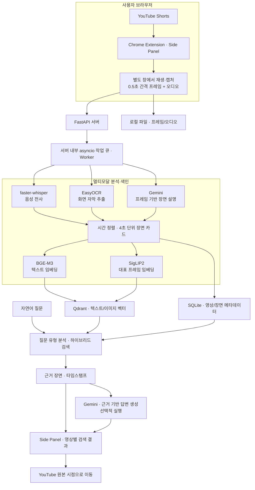
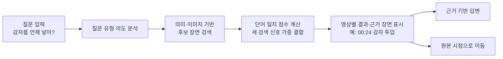

# 다 찾아드림

### 멀티모달 RAG 기반 지능형 비디오 검색 시스템

> 저장한 쇼츠에서 필요한 순간을 자연어로 찾고, 근거 장면과 함께 원본 영상의 해당 시점으로 이동합니다.

[프로젝트 소개](#1-프로젝트-소개) · [배경 및 문제](#2-배경-및-문제) · [목표](#3-목표) · [시스템 아키텍처](#4-시스템-아키텍처) · [검색 흐름](#5-검색-흐름) · [핵심 기술](#6-핵심-기술) · [실험 및 사용자 평가](#7-실험-및-사용자-평가) · [데모 흐름](#8-데모-흐름)

## 1. 프로젝트 소개

**다 찾아드림**은 YouTube Shorts의 음성·화면 자막·이미지를 함께 분석해, 저장된 영상에서 사용자의 질문에 맞는 장면을 찾아주는 Chrome 확장 프로그램 기반 시스템입니다.

사용자는 영상을 다시 훑는 대신 **“감자를 언제 넣어?”**, **“간장은 몇 큰술 넣어?”**, **“노릇하게 익은 장면 찾아줘”**처럼 질문할 수 있습니다. 시스템은 관련 장면의 이미지, 음성 전사, 자막, 타임스탬프를 제시하고, 검색된 근거를 바탕으로 답변을 생성합니다. 시점 버튼을 누르면 YouTube에서 해당 구간을 바로 확인할 수 있습니다.

현재 구현과 평가는 **요리 쇼츠의 재료·분량, 조리 순서·타이밍, 시각적 상태 탐색**을 중심으로 진행했습니다.

| 항목 | 내용 |
| --- | --- |
| 프로젝트 | 2026 졸업작품 · 다 찾아드림 |
| 팀원 | 박현준 · 이동현 · 이태연 · 임준서 |
| 지도교수 | 김준석 교수님 |
| 참여기업 | KT |
| 사용 환경 | Chrome 확장 프로그램 + Python API 서버 |

## 2. 배경 및 문제

숏폼 콘텐츠는 짧은 시간에 많은 정보를 전달하지만, **한 번 본 정보를 나중에 다시 찾기 어렵습니다.** 영상을 저장해 두더라도 제목이나 썸네일만으로는 필요한 내용이 어느 구간에 있는지 알기 어렵고, 사용자는 영상을 반복해서 재생하거나 직접 스크롤해야 합니다.

특히 요리 영상의 정보는 여러 형태로 나뉘어 있습니다.

| 정보가 있는 곳 | 예시 | 하나의 정보원만 사용할 때의 한계 |
| --- | --- | --- |
| 음성 | “이제 감자를 넣어주세요” | 화면에만 표시된 정확한 분량을 놓칠 수 있음 |
| 화면 자막 | “감자 300g”, “간장 2큰술” | 말로만 설명한 순서나 타이밍을 놓칠 수 있음 |
| 시각적 장면 | 재료의 모양, 익은 정도, 사용하는 도구 | 비슷한 조리 장면 사이의 세부 시점을 구분하기 어려움 |

따라서 영상 전체를 요약하거나 한 가지 정보만 검색하는 방식에 더해, **여러 정보원을 시간에 맞춰 연결하고 원하는 장면까지 안내하는 검색 방식**이 필요합니다.

## 3. 목표

1. **멀티모달 정보 분석·색인**: 음성, 화면 자막, 프레임의 시각 정보를 함께 분석하고 시간 구간별 장면 카드로 구성합니다.
2. **자연어 기반 장면 검색**: 질문 유형에 따라 의미 유사도, 단어 일치, 이미지 유사도를 결합해 관련 장면을 찾습니다.
3. **근거 기반 답변 제공**: 검색된 장면의 전사·자막·설명을 근거로 답변을 생성하고, 사용자가 근거를 직접 확인할 수 있게 합니다.
4. **원본 시점 연결**: 검색 결과를 YouTube의 해당 시점으로 연결해 반복 탐색에 드는 시간을 줄입니다.

## 4. 시스템 아키텍처

시스템은 **영상 수집 → 멀티모달 분석·색인 → 하이브리드 검색 → 근거 기반 RAG**로 구성됩니다. 아래는 `.env.example`의 로컬 모델 조합을 기준으로 한 구조입니다.



| 구성 요소 | 역할 |
| --- | --- |
| Chrome 확장 프로그램 | 영상 저장, 프레임·오디오 캡처, 보관함·검색 UI, 원본 시점 이동 |
| FastAPI + Worker | 업로드, 분석 작업 실행, 진행 상태 관리, 검색 API 제공 |
| Qdrant | 장면별 텍스트·이미지 벡터 저장 및 유사도 검색 |
| SQLite | 영상·장면·재생목록·분석 상태 등 메타데이터 관리 |
| 로컬 파일 저장소 | 캡처 프레임과 오디오 보관 |
| Gemini | 색인 단계의 장면 설명, 검색 시 선택적 RAG 답변 생성 |

서버가 YouTube 영상 파일을 직접 다운로드하는 대신, **확장 프로그램이 브라우저에서 재생한 화면과 오디오를 추출해 서버에 업로드**합니다. 음성 전사·OCR·임베딩은 로컬에서 실행하며, 장면 설명과 RAG 답변 생성에는 외부 API를 사용합니다. SigLIP2 이미지 검색을 위한 질의 번역도 설정에 따라 외부 호출이 발생할 수 있습니다.

현재 데모는 SQLite, 서버 내부 작업 큐, Qdrant 로컬 파일 모드를 사용합니다. 사용자별 데이터는 `user_id`로 구분하며, 사용자 식별은 확장 프로그램이 생성한 UUID와 `X-User-Id` 헤더를 사용하는 데모 방식입니다.

### 4.1. 기술 스택

| 구분 | 기술 | 용도 |
| --- | --- | --- |
| 프론트엔드 | JavaScript · HTML · CSS | Side Panel 보관함·검색 UI |
| 브라우저 확장 | Chrome Extension Manifest V3 · Chrome APIs | 영상 정보 수집, 캡처 제어, 원본 시점 이동 |
| 백엔드 | Python · FastAPI · Uvicorn | 업로드·보관함·검색 API 제공 |
| 비동기 처리 | asyncio | 서버 내부 작업 큐와 분석 Worker 실행 |
| 음성 인식 | faster-whisper | 음성 전사 및 발화 시각 추출 |
| 화면 문자 인식 | EasyOCR | 프레임 내 자막·재료·분량 추출 |
| 텍스트 임베딩 | BGE-M3 · FlagEmbedding | 장면 텍스트와 질문의 의미 유사도 검색 |
| 이미지 임베딩 | SigLIP2 · PyTorch · Hugging Face Transformers | 질문과 대표 프레임의 이미지 유사도 검색 |
| 생성형 AI | Gemini API · Google Gen AI SDK | 장면 설명, 근거 기반 답변, 이미지 검색용 질의 번역 |
| 벡터 저장소 | Qdrant | 텍스트·이미지 벡터 저장 및 검색 |
| 메타데이터 저장소 | SQLite | 영상·장면·재생목록·분석 상태 관리 |

## 5. 검색 흐름

**“감자를 언제 넣어?”**라는 질문을 예로 들면 다음과 같이 동작합니다. 아래 시각과 문구는 흐름을 설명하기 위한 예시입니다.



1. **질문 입력**: 보관함 전체, 재생목록 또는 특정 영상을 대상으로 자연어 질문을 입력합니다.
2. **질문 분석**: 규칙 기반으로 일반·음성 중심, 시각 중심, 수량·단어 중심 유형을 판단하고, 영상 찾기·장면 찾기·요약 요청의 의도를 구분합니다.
3. **후보 검색**: 사용자와 검색 범위에 해당하는 장면에서 BGE-M3 의미 유사도와 SigLIP2 이미지 유사도로 후보를 가져옵니다.
4. **점수 결합**: 후보의 단어 일치 점수를 계산한 뒤, 질문 유형별 가중치로 세 검색 점수를 합쳐 순위를 정합니다.
5. **근거 확인**: 결과를 영상별로 묶어 표시하고, 영상을 펼치면 관련 장면의 이미지·전사·자막·시점을 확인할 수 있습니다. 근거 점수가 낮으면 경고를 함께 표시합니다.
6. **답변·시점 이동**: 검색된 장면을 근거로 답변을 생성하고, 시점 버튼을 누르면 원본 영상으로 이동합니다. 앞선 맥락을 볼 수 있도록 기본 설정에서는 장면 시작보다 1.5초 먼저 재생합니다.

## 6. 핵심 기술

### 6.1. 멀티모달 근거의 시간 정렬

음성 전사에는 발화 구간이, OCR과 장면 설명에는 프레임 시각이 연결됩니다. 이를 **기본 4초 단위 장면 카드**로 통합해 “무슨 내용인가”와 “언제 나오는가”를 함께 저장합니다.

```json
{
  "segment_id": "example_video_seg_006",
  "start_time": 24.0,
  "end_time": 28.0,
  "asr_text": "감자를 넣어주세요",
  "ocr_text": "감자 300g",
  "caption": "손질한 감자를 냄비에 넣는 모습",
  "frame_path": "frames/00026000.jpg"
}
```

위 카드는 설명용 예시입니다. 텍스트 검색에는 제목·음성 전사·OCR·장면 설명을 결합한 텍스트를 사용하고, 이미지 검색에는 카드의 대표 프레임을 사용합니다. 인접 장면 병합도 실험했으나 전체 검색 성능의 이득을 확인하지 못해, 현재는 고정 분할을 유지합니다.

### 6.2. 질문 유형별 하이브리드 검색

**음성·자막·장면 설명·이미지라는 네 정보원**을 **의미·단어·이미지라는 세 검색 채널**로 활용합니다.

```text
S = w_semantic × S_semantic
  + w_lexical  × S_lexical
  + w_image    × S_image
```

| 검색 채널 | 기술 | 활용 |
| --- | --- | --- |
| 의미 유사도 | BGE-M3 텍스트 임베딩 | 표현이 달라도 의미가 가까운 장면 검색 |
| 단어 일치 | IDF 가중 단어 매칭 | 재료명·수량처럼 정확한 표현이 중요한 질문 보완 |
| 이미지 유사도 | SigLIP2 텍스트-이미지 임베딩 | 색상·도구·형태 등 시각적 단서 보완 |

텍스트·이미지 유사도는 후보 집합 내에서 각각 min-max 정규화하고, 단어 점수와 가중 결합합니다. 현재 가중치는 `server/search.py`에 정의된 규칙 기반 설정값입니다.

| 질문 유형 | 예시 | 의미 | 단어 | 이미지 |
| --- | --- | ---: | ---: | ---: |
| 일반·음성 중심 | “감자 언제 넣어?” | 0.5 | 0.3 | 0.2 |
| 시각 중심 | “빨간 냄비 나오는 장면” | 0.3 | 0.1 | 0.6 |
| 수량·단어 중심 | “간장 2큰술 넣는 장면” | 0.3 | 0.5 | 0.2 |

SigLIP2에는 사전학습 모델을 사용합니다. 파인튜닝과 선형 정렬을 실험했지만 실제 쇼츠에서 일관된 이득을 확인하지 못해 학습한 가중치를 적용하지 않았습니다. 이미지 채널의 질의에는 영어 번역·소문자화·템플릿 전처리를 적용할 수 있으며, 번역 결과는 캐시해 재사용합니다.

### 6.3. 근거 기반 RAG와 낮은 신뢰도 경고

검색한 장면의 **영상 제목, 시간 구간, 음성 전사, 자막, 장면 설명**을 Gemini의 답변 문맥으로 전달합니다. 프롬프트는 제공된 근거 안에서 답하고 확인되지 않는 정보는 모른다고 답하도록 지시합니다. 답변 생성이 실패하더라도 장면 검색 결과는 확인할 수 있습니다.

또한 정규화 전 텍스트 유사도를 바탕으로 `low_confidence`를 판정합니다. 현재 운영 임계값은 `NO_ANSWER_THRESHOLD=0.52`이며, 근거가 약하면 **“확실히 맞는 것을 찾지 못했습니다”**라는 경고를 표시합니다. 결과를 숨기거나 답변 생성을 강제로 막는 방식은 아닙니다.

### 6.4. 교체 가능한 분석 단계와 실험 재현성

음성·OCR·텍스트 임베딩·이미지 임베딩 백엔드는 설정으로 교체할 수 있습니다. 저장해 둔 동일한 프레임과 오디오를 재사용하고, 제품과 실험이 같은 분석·검색 함수를 호출하도록 구성해 조건별 차이를 비교합니다. 단계별 분석 상태도 기록해 정상적인 빈 결과와 처리 실패를 구분합니다.

## 7. 실험 및 사용자 평가

포스터와 저장소의 공식 결과를 기준으로 정리했습니다. 검색 성능은 **2026-10-21**, 사용자 평가는 **2026-10-26** 측정 결과입니다.

### 7.1. 검색 성능

평가 데이터는 **영상 18개, 장면 카드 203개**입니다. 수집한 질문 64개 중 검색 성능은 **정답이 있는 질문 48개**로 측정했고, 정답이 없는 질문 12개는 별도로 평가했습니다. 나머지 4개는 해당 영상이 공용 색인에 없어 제외했습니다. 질문은 팀 외부에 의뢰하고 정답 시간 구간은 팀원이 라벨링했습니다.

| 지표 | 음성 단일 기준선 | 현행 시스템 |
| --- | ---: | ---: |
| nDCG@5 | 0.719 | **0.745** |
| 1위 적중률 | 62.5% | **68.8%** |
| mAP | 0.607 | **0.621** |
| Recall@5 | 0.802 | 0.802 |

nDCG@5는 상위 5개 결과의 관련도와 순서를, 1위 적중률은 첫 결과가 정답에 해당하는 비율을 나타냅니다. mAP는 정답 결과의 순위 품질을, Recall@5는 상위 5개 결과가 정답을 얼마나 포함하는지를 봅니다.

이 평가는 **지정된 영상 안에서 장면을 찾는 과제**입니다. 또한 위 음성 기준선은 현행 시스템의 후보를 음성 정보로 재정렬하는 방식이므로, 완전히 독립된 음성 전용 검색 시스템과의 비교에는 한계가 있습니다. 정보원별 재색인 실험은 아래 제거 실험에서 별도로 수행했습니다.

### 7.2. 정보원별 기여도

음성·자막·장면 설명·이미지의 **15개 조합**을 각각 색인해 비교했습니다. 아래는 포스터에 제시한 주요 조건의 nDCG@5입니다.

| 조건 | nDCG@5 |
| --- | ---: |
| 현행 전체: 음성 + 자막 + 설명 + 이미지 | 0.745 |
| 장면 설명 제외 | **0.772** |
| 자막 제외 | 0.765 |
| 음성 제외 | 0.697 |
| 이미지만 사용 | 0.470 |

**정보원을 모두 추가한다고 성능이 항상 좋아지지는 않았습니다.** 장면 설명을 제외한 조건의 전체 평균이 더 높았고, 이미지 단독 검색은 장면 구분에 한계를 보였습니다. 장면 설명의 효과는 질문 유형에 따라 달랐으며, 특히 재료·분량 질문에서는 설명을 제외한 조건이 더 좋았습니다. 이미지 정보는 다른 정보원을 보완하는 신호로 활용합니다.

표본이 작아 모든 조건의 차이를 통계적으로 확정할 수는 없습니다. 특히 장면 설명 제외 조건의 전체 평균 개선폭은 신뢰구간이 0을 포함하므로, **해당 조건이 항상 우수하다고 일반화하지 않습니다.**

### 7.3. 사용자 평가

참가자 **10명**이 각각 두 조건에서 3개씩, 총 **60과제**를 수행했습니다. 같은 참가자가 직접 탐색과 제안 시스템을 모두 사용하되, 과제를 두 묶음으로 나누고 조건·과제 세트 순서를 교차 배정했습니다. 제안 시스템에서는 참가자가 직접 검색어를 작성했습니다.

| 항목 | YouTube 직접 탐색 | 제안 시스템 |
| --- | ---: | ---: |
| 평균 소요 시간 | 27.3초 | **9.3초** |
| 평균 시도 횟수 | 1.56회 | **1.10회** |
| 사전 기준 성공률 | 28/30 (93.3%) | 25/30 (83.3%) |
| 정답 구간 전체를 인정한 대안 기준 성공률 | 30/30 (100%) | 29/30 (96.7%) |

평균 탐색 시간은 **약 66% 감소**했고, 참가자 10명 모두에서 제안 시스템의 평균 시간이 더 짧았습니다. 참가자별 시간 차이에 대한 부호검정 결과는 `p ≈ 0.002`입니다. 위 시간은 원자료의 조건별 30과제에 기록된 소요 시간 평균이며, 직접 탐색의 시도 횟수는 기록이 누락된 3건을 제외한 값입니다.

성공률은 두 기준을 함께 제시합니다. 사전 기준은 **정답 시작 시각의 이전 5초~이후 2초**였으나, 일부 과제의 정답 구간이 6~11초로 길어 **정답 구간 안에 도달해도 실패로 판정되는 사례**가 발생했습니다. 대안 기준은 정답 구간 전체에 같은 여유를 적용한 사후 분석입니다. 따라서 이 평가에서는 **탐색 시간 감소가 관찰됐으며, 성공률 개선은 확인되지 않았습니다.**

참가자가 시점 이동 기능을 발견하지 못한 사례도 있어, 검색 결과에서 이동 버튼을 더 쉽게 찾도록 UI를 개선할 필요가 있습니다. 소규모 요리 영상 탐색 실험이며, 일반 영상 전체의 검색 성능이나 RAG 답변 품질을 평가한 결과는 아닙니다.

### 7.4. 처리 시간과 한계

- **저장 비용**: 실험 환경에서 영상 길이 평균 47초에 서버 처리 평균 112초가 추가로 소요됐습니다. 캡처는 실시간 재생 방식입니다.
- **외부 API 의존성**: 장면 설명과 RAG 답변은 할당량·지연·오류의 영향을 받습니다. 장면 설명 호출 상한은 영상당 1회이며, 검색 답변 생성과 질의 번역 호출은 별도입니다.
- **설명 범위**: 평가 당시 장면 설명은 165/203개 카드, 약 81%에 채워져 있었습니다. 그리드 프레임 수와 호출 상한 때문에 모든 카드에 설명이 생성되지는 않습니다.
- **평가 범위**: 검색 질문 48개, 사용자 10명의 제한된 표본이며 정답 라벨의 라벨러 간 일치도는 측정하지 않았습니다. 더 다양한 영상·질문으로 추가 검증이 필요합니다.

근거 자료: [공식 검색 결과](eval/result_20261021.json), [정보원 제거 실험](eval/ablation.json), [사용자 평가 원자료](eval/user_study_raw.csv), [평가 설계](docs/user-study.md), [실험 상세 및 한계](docs/PROGRESS.md).

## 8. 데모 흐름

**저장 영상 보관함 → 자연어 검색 → 관련 장면과 근거 확인 → 레시피·원본 시점 이동** 순서로 시연합니다.

| 단계 | 사용자 행동 | 확인할 동작 |
| --- | --- | --- |
| 1. 영상 저장 | YouTube Shorts에서 Side Panel을 열고 **이 쇼츠 저장** 클릭 | 별도 저장 창에서 재생·캡처, 분석 진행률 표시 |
| 2. 보관함 확인 | 분석이 끝난 영상 카드 선택 | 요약, 주요 단계, 재료 목록 확인 |
| 3. 자연어 검색 | “감자를 언제 넣어?”처럼 질문 입력 | 근거 기반 답변과 영상별 검색 결과 표시 |
| 4. 근거 장면 확인 | 검색 결과의 영상을 펼치기 | 관련 장면의 이미지·전사·자막·타임스탬프 확인 |
| 5. 원본 시점 이동 | 장면의 **▶ 시점 버튼** 클릭 | YouTube 해당 구간으로 이동·재생 |
| 6. 정보 활용 | 영상 상세의 사진 레시피와 재료 목록 확인 | 단계별 시점 이동, 쿠팡·네이버쇼핑 검색 링크 활용 |
| 7. 낮은 신뢰도 확인 | “강아지 산책시키는 장면”처럼 저장한 요리 영상과 다른 질문 입력 | 근거가 약한 결과에 경고 표시 |

시연 검색어는 실제 저장한 영상의 내용에 맞춰 준비합니다. 영상 저장·분석은 미리 완료해 두면 검색과 시점 이동을 바로 보여줄 수 있습니다. 저장 과정 자체를 보여줄 때는 별도 창에서 캡처하는 동안 원래 창에서 다른 쇼츠를 탐색할 수 있는 동작도 확인할 수 있습니다.

<details>
<summary><strong>데모 실행 방법</strong></summary>

저장소 루트에서 실행합니다. 아래는 Windows PowerShell 기준이며, Python 3.12 가상환경 예시입니다.

```powershell
git clone https://github.com/dgli0410/2026_graduate_project.git
cd 2026_graduate_project

py -3.12 -m venv .venv
.\.venv\Scripts\Activate.ps1
python -m pip install -r requirements.txt
python -m pip install faster-whisper easyocr FlagEmbedding torch "transformers>=4.45" "peft>=0.12" accelerate

Copy-Item .env.example .env
```

`.env`에 `GEMINI_API_KEY`를 입력하고, 아래 백엔드 설정을 확인합니다. API 키는 [Google AI Studio](https://aistudio.google.com/apikey)에서 발급할 수 있습니다. 첫 실행 시 로컬 모델 다운로드와 로딩 시간이 필요합니다.

```dotenv
ASR_BACKEND=faster-whisper
OCR_BACKEND=easyocr
TEXT_EMBED_BACKEND=bge
IMAGE_EMBED_BACKEND=siglip
SIGLIP_QUERY_TRANSLATE=true
DEVICE=cpu
```

```powershell
python -m uvicorn server.main:app --port 8000
```

1. Chrome에서 `chrome://extensions`를 열고 **개발자 모드**를 켭니다.
2. **압축해제된 확장 프로그램을 로드합니다**를 눌러 저장소의 `extension` 폴더를 선택합니다.
3. YouTube Shorts를 열고 확장 아이콘을 눌러 Side Panel을 엽니다.
4. 저장·분석이 끝나면 보관함과 검색 기능을 사용합니다.

API 문서는 `http://localhost:8000/docs`에서 확인할 수 있습니다. 기본 Qdrant는 로컬 파일 모드이므로 별도 Docker 구성이 필요하지 않습니다. 로컬 Qdrant의 프로세스 잠금 충돌을 피하도록 서버는 한 프로세스로 실행합니다. 다른 YouTube 확장과 충돌하면 개발용 Chrome 프로필에서 실행합니다.

</details>

<details>
<summary><strong>코드와 추가 문서</strong></summary>

| 경로 | 내용 |
| --- | --- |
| `extension/` | 브라우저 캡처, Side Panel UI, 시점 이동 |
| `server/main.py` | 업로드·보관함·검색 API |
| `server/pipeline/` | 음성 전사, OCR, 장면 설명, 시간 정렬, 요약, Worker |
| `server/search.py` | 질문 분석, 하이브리드 점수 결합, RAG 답변 |
| `server/config.py` | 모델·검색·저장소 설정 |
| `eval/` | 검색 평가 결과, 제거 실험, 사용자 평가 원자료 |

실험의 상세 조건과 제약은 [진행 상황 통합 문서](docs/PROGRESS.md), 평가셋 작성 방식은 [평가 가이드](docs/eval-guide.md)를 참고합니다.

</details>

본 프로젝트는 개인 학습·연구 목적의 졸업작품입니다. 검색 결과의 영상 재생은 YouTube에서 이루어지며, 시스템에는 검색을 위한 캡처 프레임·오디오·분석 결과가 저장됩니다.
