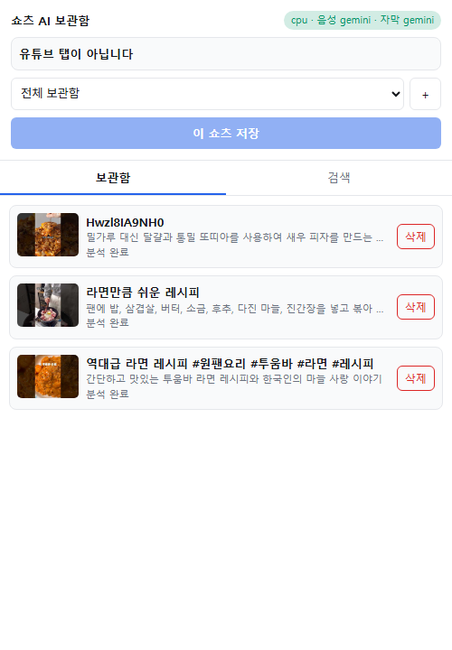
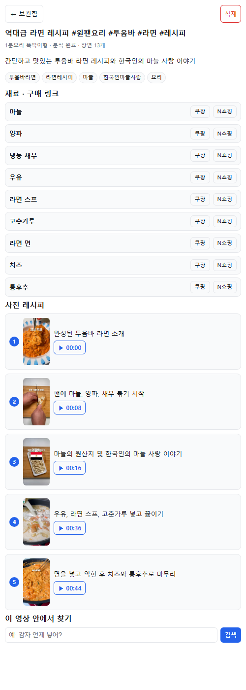

## 전체 파이프라인 아키텍처 링크 
https://claude.ai/artifact/5WGjQ6R3eRwXhjYQ4oygU9


# 쇼츠 AI 보관함 — Demo

마스터 문서(확정본)의 파이프라인을 **한 노트북에서 끝까지 돌아가게** 만든 최소 구현입니다.
저장 → 추출 → 분석 → 요약 → 검색 → 시점 이동까지 전 구간이 이어집니다.

**서버는 유튜브에 한 번도 접속하지 않습니다.** 화면과 소리는 확장프로그램이
브라우저에서 뽑아 올립니다(마스터 문서 2장).

```
크롬 확장 (Side Panel)
   │ ① 저장 버튼 → 메타데이터 접수
   │ ② **별도 창**을 띄워 거기서 재생하며 프레임(0.5초마다) + 오디오 추출   ★ 핵심
   │    → 사용자는 원래 창에서 다른 쇼츠를 계속 봐도 됩니다
   ▼
API 서버 (FastAPI) → 작업 큐 → Worker
                                ├ 단계 4  음성 받아적기   faster-whisper (로컬)
                                ├ 단계 5  화면 글자 읽기  EasyOCR (로컬)
                                ├ 단계 6  장면 설명       Gemini — **유일한 외부 호출, 영상당 1회**
                                ├ 단계 7  4초 장면 카드
                                ├ 단계 8  글 좌표 BGE-M3 + 그림 좌표 SigLIP2 (로컬) → Qdrant
                                └ 단계 9  전체 요약 + 재료 목록
   │ 3초마다 진행률 확인
   ▼
검색 → 하이브리드(글·단어·그림) + user_id 필터
   → **영상 목록**으로 보여주고, 영상을 펼치면 그 안 장면
   → 근거가 약하면 "확실히 맞는 것을 찾지 못했습니다" 경고
   → 장면을 누르면 유튜브의 그 초로 이동
```

---

## 미리보기

<p align="center">
  
  
</p>

### 최근 업데이트

| 기능 | 설명 |
| --- | --- |
| **저장이 별도 창에서** | 저장을 누르면 작은 창이 뜨고 거기서 추출합니다. **그동안 다른 쇼츠를 봐도 됩니다.** 창을 완전히 덮어도 안전한 것을 실측했습니다(틱 간격 501ms / 목표 500ms, 화질 1280 유지) |
| **검색 결과가 영상 목록** | 장면이 평평하게 섞여 나오던 것을 영상 단위로 묶고, 영상을 펼쳐야 그 안 장면이 나옵니다. "이런 영상 찾아줘" 는 1개, "간장 넣는 장면" 은 걸린 영상 전부 |
| **"관련 장면 없음" 경고** | 근거가 약하면 알려줍니다(멘토 자문 3번). 정규화 전 유사도 0.52 기준 — 평가셋으로 고른 값 |
| 제목·채널 추출 안정화 | 화면에 보이는 reel 만 읽어 preload 된 다른 쇼츠의 제목·채널이 섞이는 문제 수정 |
| 재료 → 구매 링크 | 요약할 때 재료 목록을 함께 추출 → 재료마다 쿠팡/네이버쇼핑 검색 버튼. `.env` 에 `NAVER_CLIENT_ID/SECRET`(무료)을 넣으면 최저가·판매처 표시 |
| 사진 레시피 | 주요 단계를 번호 배지 + 스틸컷 + 단계 설명 + ▶시점 버튼 카드로 표시. 프레임이 이미 저장돼 있어 서버 변경 없음 |

> 예전에 분석한 영상은 재료가 비어 있습니다. 다시 저장할 필요 없이
> `python -m tools.backfill_ingredients` 한 번이면 채워집니다.

---

> ### 🚀 처음 받았다면 (팀원용 요약)
>
> 1. `python -m venv .venv` → `.venv\Scripts\activate` → `pip install -r requirements.txt`
> 2. **본인 Gemini 키를 발급받으세요** → https://aistudio.google.com/apikey (무료)
> 3. `.env.example` 을 `.env` 로 복사하고 `GEMINI_API_KEY=` 에 붙여넣기
> 4. `python -m uvicorn server.main:app --port 8000`
> 5. `chrome://extensions` → 개발자 모드 → `extension` 폴더 로드
> 6. **다른 유튜브 확장 전부 끄기** ← 안 끄면 원인 불명 버그로 며칠 날립니다
>
> `.env` 는 저장소에 없습니다(각자 키를 씁니다). 도커·GPU 없이 그냥 돕니다.
> 잘 안 되면 `python -m tools.e2e_test` 로 어디서 막히는지 먼저 보세요.

---

## 0-1. 지금 성적

| | nDCG@5 | Recall@5 | 1위적중 |
| --- | ---: | ---: | ---: |
| 기준선 — 음성 단일 신호 | 0.728 | 0.812 | 0.667 |
| **현행 시스템** | **0.756** | 0.812 | 0.729 |

영상 18개 / 장면 카드 203개 / 평가셋 질문 64개 · 라벨 113줄 (2026-10-13).
**설명 채움률이 55% 인 상태에서 잰 값이라 확정값이 아닙니다** — 자세한 것은
[`docs/PROGRESS.md`](docs/PROGRESS.md) 6장.

---

## 0-2. 문서

**문서가 많아 보이지만 평소에 볼 것은 위 4개뿐입니다.** 나머지는 기록 보존용입니다.

| 지금 보는 것 | 내용 |
| --- | --- |
| [`docs/PROGRESS.md`](docs/PROGRESS.md) | **★ 통합본.** 9/18 자문 이후 진행 상황 전체 — 무엇을 고쳤고, 지금 성적이 얼마고, 다음에 뭘 하는지. **멘토 보고·팀 공유는 이것 하나로** |
| [`docs/eval-guide.md`](docs/eval-guide.md) | 질문셋·평가셋 만드는 법 (질문 작성자·라벨러용 작업 지침) |
| [`docs/plan-and-roles.pdf`](docs/plan-and-roles.pdf) | **추진 일정표 · 역할 분담표** (제출용 2쪽) |
| [`docs/user-study-guide.pdf`](docs/user-study-guide.pdf) | 사용자 평가 진행 안내서 (인쇄용 2쪽) |
| [`docs/user-study-forms.pdf`](docs/user-study-forms.pdf) | **평가지** (인쇄용, 참가자 1인당 1장 × 10) |
| [`docs/user-study.md`](docs/user-study.md) | 사용자 평가 **설계 근거** — 왜 이렇게 설계했는지 |
| [`eval/video_list.md`](eval/video_list.md) | 저장된 영상 목록 |
| [`CLAUDE.md`](CLAUDE.md) | Claude Code 작업 지침 |

| 세부 기록 (필요할 때만) | 내용 |
| --- | --- |
| [`docs/fixes-20261005.md`](docs/fixes-20261005.md) | 박현준 10/05 수정 상세 |
| [`docs/fixes-20261010.md`](docs/fixes-20261010.md) | 이동현 10/09~10 수정 상세 |
| [`eval/ablation.json`](eval/ablation.json) | 제거법 15조건 원자료 (문항별 점수) |
| [`eval/merge_experiment.json`](eval/merge_experiment.json) | 의미 단위 병합 실험 원자료 |
| [`eval/threshold.json`](eval/threshold.json) | 거절 임계값 곡선 원자료 |
| [`SigLIP2_실험기록_20260914.md`](SigLIP2_실험기록_20260914.md) | SigLIP2 파인튜닝 실험 전문 |
| [`docs/mentor-feedback.md`](docs/mentor-feedback.md) | 9/18 자문 원문과 그때 세운 계획 |
| [`docs/meeting-brief-20261010.md`](docs/meeting-brief-20261010.md) | 10/10 회의 브리핑 (붙여넣기용) |

| ⚠ 낡음 — 그대로 인용하지 말 것 | 이유 |
| --- | --- |
| [`docs/search-logic.md`](docs/search-logic.md) | 9/22 기준. 여기 적힌 문제 대부분이 이후 고쳐졌습니다 |
| [`docs/MENTOR_BRIEF.md`](docs/MENTOR_BRIEF.md) | 9/22 기준. 백엔드 설정·측정치가 옛날 값입니다 |
| [`docs/team-meeting.md`](docs/team-meeting.md) | 9/29 기준. 결정 사항이 이후 바뀌었습니다 |

## 0-3. 이용 범위 (저작권)

이 시스템은 **개인 학습·연구 목적의 졸업작품**이며 상용 서비스가 아닙니다.

설계상 **서버는 유튜브에 한 번도 접속하지 않습니다.** 영상 파일을 내려받지 않고, 사용자가
**자신의 브라우저에서 이미 재생 중인 화면**을 확장 프로그램이 캡처해 올립니다. 저장되는
것은 원본 영상이 아니라 **0.5초 간격 정지 이미지와 그로부터 추출한 텍스트**(자막·음성
전사·장면 설명)이며, 검색 결과는 영상을 재생해 주는 것이 아니라 **유튜브의 해당 시점으로
이동**시킵니다. 재생은 항상 유튜브에서 일어납니다.

따라서 `yt-dlp` 같은 영상 파일 다운로드와는 성격이 다릅니다. 다만 **외부 플랫폼 콘텐츠를
가공·보관한다는 점은 동일하므로, 서비스화한다면 유튜브 이용약관 검토가 선행되어야
합니다.** 현재 데이터는 전부 사용자 로컬(`data/`)에만 저장되며 외부로 공유되지 않습니다.

## 1. 실행 방법

### 서버

```bash
cd shorts-vault-demo
python -m venv .venv
.venv\Scripts\activate            # macOS/Linux: source .venv/bin/activate
pip install -r requirements.txt

copy .env.example .env            # macOS/Linux: cp .env.example .env
# .env 에 GEMINI_API_KEY 를 채우세요 (https://aistudio.google.com/apikey)

python -m uvicorn server.main:app --port 8000
```

`http://localhost:8000/docs` 에서 API 를 직접 눌러볼 수 있습니다.

> **도커는 필요 없습니다.** Qdrant 를 `data/qdrant` 폴더에 로컬 파일로 돌립니다.
> 4명이 창고를 공유할 때만 `.env` 에 `QDRANT_URL` 을 넣으세요.

### 크롬 확장

1. `chrome://extensions` 열기 → 오른쪽 위 **개발자 모드** 켜기
2. **압축해제된 확장 프로그램을 로드합니다** → `extension` 폴더 선택
3. 유튜브 쇼츠를 열고 확장 아이콘 클릭 → 오른쪽에 Side Panel 이 열립니다

> ⚠ **다른 유튜브 확장을 전부 끄세요.** 마스터 문서 6장의 경고대로 충돌이 납니다.
> 개발 전용 크롬 프로필을 따로 만드시길 권합니다.

## 2. 확인 도구 — 어디까지 되는지 단계별로

```bash
# ① Gemini 없이: 장면 카드 합치기 / 검색 비중 / 중복 제거
python -m tools.smoke_test

# ② 사용자 격리 — 남의 영상이 내 검색에 나오지 않는지  ★ 보안 핵심
python -m tools.test_user_isolation

# ③ 쓸 수 있는 Gemini 모델과 응답 속도 (503 이 나면 여기부터)
python -m tools.check_models

# ④ Gemini 연동 4곳 (캡션·OCR / 음성 / 글 좌표 / RAG)
python -m tools.check_gemini

# ⑤ 서버 전 구간 e2e — 확장 없이 가짜 프레임으로 업로드→분석→검색→삭제
#    (다른 창에서 서버를 먼저 띄워두세요)
python -m tools.e2e_test

# ⑥ 조건별 배치 재분석 (비교 실험용, 서버 필요)
python -m tools.run_condition --list
python -m tools.run_condition --condition local

# ⑦ 검색 성능 측정 — 평가셋으로 (서버 필요, Gemini 호출 0회)
python -m tools.eval_search --all
```

### 측정 도구 (멘토 자문 대응)

```bash
python -m tools.ablation --yes          # 신호 4개 15조건 전수      (서버 끄고)
python -m tools.merge_experiment --yes  # 의미 단위 병합 전후        (서버 끄고)
python -m tools.threshold_sweep         # 거절 임계값 곡선          (서버 켜고)
python -m tools.cost_report             # 영상당 처리 시간·호출 수
python -m tools.backfill_ingredients    # 예전 영상의 재료 채우기
```

⚠ `--yes` 가 붙는 둘은 Qdrant 에 실험용 창고를 만듭니다. **서버를 끄고** 돌리고,
끝나면 `--cleanup` 으로 지우세요. 제품 창고는 건드리지 않습니다.

**①~⑤가 다 통과하면 서버 쪽은 끝입니다.** 남는 건 브라우저 추출(단계 2)뿐이고,
그건 실제 쇼츠에서 저장 버튼을 눌러봐야 알 수 있습니다.

## 3. 시연 시나리오 (마스터 문서 10장 그대로)

1. 유튜브 쇼츠를 연다
2. 확장 아이콘 클릭 → Side Panel 열림
3. (선택) `＋` 로 재생목록을 만들고 고른다
4. **이 쇼츠 저장** → 오른쪽에 **저장 창**이 뜨고 거기서 추출이 돕니다 (영상 길이만큼).
   화면이 넓으면 원래 창이 자동으로 좁아져 자리를 비웁니다
5. **이때 원래 창에서 다른 쇼츠를 계속 봐도 됩니다** ← 시연에서 보여줄 지점
6. 업로드 후 진행률 20 → 40 → 65 → 85 → 95 → 100%. 끝나면 저장 창이 닫히고
   원래 창 크기가 돌아옵니다
7. 완료되면 카드에 요약 한 줄. 카드를 누르면 상세 — 주요 단계 시각 버튼,
   **재료마다 쿠팡·네이버쇼핑 검색 버튼**
8. **검색** 탭에서 `감자 언제 넣어?` → AI 답변 + **영상 목록**
9. 영상 줄의 `▾` 를 누르면 펼쳐져 그 안 장면들이 나옵니다 (장면 사진 포함)
10. `▶ 00:22` 클릭 → 유튜브 영상이 그 지점부터 재생 (1.5초 일찍).
    다른 쇼츠를 보던 중이면 그 영상으로 옮긴 뒤 이동, 실패하면 새 탭 폴백
11. **보여줄 것 하나 더**: `강아지 산책시키는 장면` 처럼 없는 것을 물어보면
    "확실히 맞는 것을 찾지 못했습니다" 경고가 뜹니다 (멘토 자문 3번)
12. 카드의 **삭제** → 표·창고·이미지 3곳에서 지워짐

## 4. 코드 구조 — 담당별 경계

| 파일 | 마스터 문서 | 담당 |
| --- | --- | --- |
| `extension/content.js` | 단계 1·2·13 — **프레임·오디오 추출**, 시점 이동 | **A** |
| `extension/sidepanel.js` | 단계 11 — 화면 전부 | **A** |
| `server/main.py`, `server/db.py`, `server/media.py`, `server/pipeline/worker.py` | 단계 3·10 | **B** |
| `server/pipeline/transcribe.py` | 단계 4 WhisperX | **C** |
| `server/pipeline/ocr.py` | 단계 5 OCR | **C** |
| `server/pipeline/segmenter.py` | 단계 7 장면 카드 | **C** |
| `server/pipeline/caption.py`, `server/pipeline/frames.py` | 단계 6 Gemini 캡션 | **D** |
| `server/embedder.py`, `server/image_embedder.py`, `server/vectors.py` | 단계 8 좌표 | **D** |
| `server/search.py` | 단계 12 하이브리드 검색 + RAG | **D** |

각 파일은 **입출력 모양만 지키면 내부를 통째로 바꿔도** 나머지가 안 깨집니다.
장면 카드 모양은 마스터 문서 6장 견본과 동일합니다:

```json
{
  "segment_id": "vid_001_seg_006",
  "start_time": 22.4,
  "end_time": 26.4,
  "asr_text": "이제 감자를 넣어줍니다",
  "ocr_text": "감자 300g",
  "caption": "손질된 감자를 프라이팬에 넣는 모습",
  "frame_path": "frames/00022000.jpg"
}
```

프레임 파일 이름이 곧 시각입니다: `00022000.jpg` = 22.0초

## 5. ⚗ 비교 탭 — Gemini vs 로컬 모델

Side Panel 세 번째 탭입니다. **보관함·검색 탭은 그대로**이고, 이 탭만 추가됐습니다.

### 원리 — 왜 공정한 비교인가

저장할 때 뽑은 프레임·오디오가 `data/media/` 에 **그대로 남아 있습니다.**
비교는 그 파일을 다시 읽어서 백엔드만 바꿔 돌립니다.

```
data/media/<user>/<video_id>/
    frames/00000500.jpg ... (163장)     ← 이 바이트는 고정
    audio.wav                            ← 이 바이트도 고정
            │
            ├─→ [gemini] Gemini 음성 + Gemini 자막 + Gemini 좌표 → shorts_segments
            └─→ [local]  WhisperX + EasyOCR + BGE-M3 + SigLIP2   → shorts_segments__local
```

입력이 완전히 같으므로 **차이는 순수하게 모델 차이**입니다.
유튜브에서 매번 새로 받아오는 방식과 달리 1년 뒤에 돌려도 같은 입력입니다.

`server/pipeline/analyze.py` 를 **제품과 실험이 똑같이** 사용합니다.
실험 숫자가 실제 제품과 다른 코드에서 나오면 그 숫자는 의미가 없기 때문입니다.

### 쓰는 법

1. `⚗ 비교` 탭 → 영상 고르기
2. `로컬 모델` 카드의 **이 조건으로 분석** 클릭
3. 끝나면 비교표가 뜹니다 (더 나은 쪽에 초록 표시)

```
항목                  Gemini API   로컬 모델
장면 카드                    22          22
말이 담긴 카드                11          14   ← 초록
자막이 담긴 카드              18          20   ← 초록
음성 분석(초)               6.9       142.3   ← Gemini 초록
총 처리 시간(초)            42.1       310.5   ← Gemini 초록
```

4. 아래 검색창에 질문을 넣으면 **양쪽 검색 결과를 나란히** 보여주고,
   둘이 같은 지점을 가리키는지 판정합니다.

영상 여러 개를 한꺼번에 돌리려면:

```bash
python -m tools.run_condition --list              # 조건·영상 목록
python -m tools.run_condition --condition local   # 전부 재분석 (밤에 걸어두세요)
```

### ⚠ 시연 전에 미리 돌려두세요

로컬 조건은 **CPU에서 영상당 3~5분**입니다. 시연 중에 실행하면 안 됩니다.
결과는 DB에 저장되므로 미리 돌려두면 탭을 열자마자 표가 뜹니다.

### 발표에서 쓰는 법

"Gemini가 더 좋았다"로 끝내면 *"그럼 로컬 모델은 왜 붙였냐"* 를 맞습니다.
**축을 쪼개면 로컬이 이기는 칸이 생깁니다.**

| 축 | Gemini | 로컬 모델 |
| --- | :---: | :---: |
| 장면 이해 품질 | **승** | |
| 처리 속도 (CPU) | **승** | |
| 시간 정밀도 | 문장 단위 | **승** (WhisperX 단어 단위) |
| 비용 | 호출당 과금 | **승** (0원) |
| 프라이버시 | 영상 내용이 외부로 | **승** (전부 로컬) |
| 재현성 | 모델이 바뀌면 결과가 바뀜 | **승** (버전 고정) |
| 외부 장애 | 503 과부하 실제 발생 | **승** (없음) |

→ 결론이 *"Gemini가 이겼다"* 가 아니라
**"용도에 따라 갈린다. 그래서 갈아끼울 수 있게 설계했다"** 가 됩니다.

## 6. 진짜 모델로 갈아끼우기

`.env` 한 줄씩만 바꾸면 됩니다. 코드는 안 건드립니다.

| 단계 | demo 기본값 | 진짜 | 바꾸는 법 | 담당 |
| --- | --- | --- | --- | --- |
| 4 음성 | Gemini | Whisper | `pip install faster-whisper` → `ASR_BACKEND=faster-whisper` | C |
| 5 자막 | Gemini 그리드 | EasyOCR | `pip install easyocr` → `OCR_BACKEND=easyocr` | C |
| 8 글 좌표 | Gemini 768차원 | BGE-M3 1024차원 | `pip install FlagEmbedding` → `TEXT_EMBED_BACKEND=bge` | D |
| 8 그림 좌표 | 없음 | SigLIP2 | `pip install torch transformers peft` → `IMAGE_EMBED_BACKEND=siglip` | D |
| GPU | `DEVICE=cpu` | `DEVICE=cuda` | **이 한 줄만** (마스터 문서 8장) | B |

> ⚠ 좌표 백엔드를 바꾸면 벡터 차원이 달라집니다. `data/qdrant` 를 지우고
> 저장된 영상을 다시 분석해야 합니다.

### ⚠ WhisperX 와 Python 버전

**WhisperX 는 Python 3.14 를 지원하지 않습니다** (모든 배포판이 `<3.14` 요구).
3.14 를 쓰고 있다면 두 가지 길이 있습니다.

| 방법 | 명령 | 얻는 것 / 잃는 것 |
| --- | --- | --- |
| **faster-whisper** (권장) | `pip install faster-whisper` | WhisperX 안에서 실제로 도는 **바로 그 엔진**(CTranslate2 Whisper). `word_timestamps` 로 **단어 단위 시각도 나옵니다.** wav2vec2 강제정렬만 빠집니다 |
| Python 3.12 venv | `py -3.12 -m venv .venv312` | 진짜 WhisperX. 정렬까지 포함해 시각이 가장 정확 |

코드는 `ASR_BACKEND=whisperx` 로 두고 whisperx 가 없으면 **자동으로
faster-whisper 로 넘어갑니다.** 팀원마다 파이썬 버전이 달라도 그대로 돕니다.

## 7. 하이브리드 검색 — 실험할 지점

`server/search.py` 의 `WEIGHTS` 가 마스터 문서 단계 12 의 비중 표입니다.
지금은 `IMAGE_EMBED_BACKEND=siglip` 이라 세 칸이 모두 적용됩니다.


```python
WEIGHTS = {
    "speech":  (0.5, 0.3, 0.2),  # "감자 언제 넣어?"
    "visual":  (0.3, 0.1, 0.6),  # "빨간 냄비 나오는 장면"
    "lexical": (0.3, 0.5, 0.2),  # "300g", "2큰술"
}   #  글 좌표, 정확한 단어, 그림 좌표
```

검색 응답에 `score_dense` / `score_lexical` / `score_image` / `score_raw` 가 들어옵니다.

**⚠ 이 가중치를 바꾸기 전에 [`docs/PROGRESS.md`](docs/PROGRESS.md) 5-2장을 보세요.**
신호별 기여도를 15조건 전수로 이미 측정했고, 거기서 나온 사실들이 설계를 바꿉니다:

- **SigLIP 단독(0.520)은 무작위(0.480)와 구별되지 않습니다.** 영상 **안에서** 맞는 순간을
  찾는 데는 거의 기여하지 않습니다. 보조 신호로는 일관되게 플러스입니다
- **재료·분량 질문은 자막 위주가 유의하게 낫고, 시각적 상태는 정반대**입니다.
  전체 평균에서 둘이 상쇄돼 0 에 가까워집니다 — 평균만 보면 틀린 결론에 갑니다
- 지금 `WEIGHTS` 의 축은 *글좌표/단어/그림* 이라 **음성·자막·설명을 따로 조절할 수
  없습니다.** 색인이 셋을 한 덩어리로 합치기 때문입니다(`segmenter.search_text()`)

실험 도구:

```bash
python -m tools.ablation --yes          # 신호 4개 15조건 전수 (서버 끄고)
python -m tools.merge_experiment --yes  # 의미 단위 병합 전후 (서버 끄고)
python -m tools.threshold_sweep         # 거절 임계값 곡선 (서버 켜고)
python -m tools.cost_report             # 영상당 처리 시간·호출 수
python -m tools.eval_search --all       # 현행 vs 기준선 (서버 켜고)
```

### `.env` 로 켜고 끄는 것

| 설정 | 기본값 | 뜻 |
| --- | --- | --- |
| `NO_ANSWER_THRESHOLD` | `0.52` | 근거가 약하면 경고. 0 이면 끔 |
| `MERGE_SIMILARITY` | `0` | 의미 단위 병합. **꺼짐** — 재보니 손해였습니다 |
| `SEEK_LOCALIZE` | `1` | 병합 카드 안에서 이동 지점 고르기 |
| `MAX_GEMINI_CALLS_PER_VIDEO` | `1` | 영상당 Gemini 호출 상한 |

## 8. Demo 에서 줄인 것

| 마스터 문서 | Demo | 바꾸는 법 |
| --- | --- | --- |
| PostgreSQL | SQLite (`data/vault.db`) | `server/db.py` 함수 시그니처 유지하며 교체 (B) |
| 작업 큐 (Redis) | 서버 안 asyncio 큐 | `worker.enqueue()` 만 교체 (B) |
| Qdrant Cloud | 로컬 파일 모드 | `.env` 에 `QDRANT_URL` |
| 로그인 | `X-User-Id` 헤더 (확장이 만든 uuid) | `main.current_user()` 교체 (B) |

## 9. 알려진 제약

- **추출은 실시간 재생입니다.** 60초 영상이면 추출도 60초가 걸립니다. 다만 **별도 창에서
  돌기 때문에 그 화면에 머무를 필요는 없습니다** — 다른 쇼츠를 보셔도 됩니다.
  (실측: 영상 길이 평균 47초 + 서버 처리 110초 = 대기 157초. `tools/cost_report.py`)
- **저장은 한 번에 하나씩입니다.** 서버는 두 개까지 동시에 분석하도록 돼 있지만
  (`worker.CONCURRENCY = 2`) 확장이 저장 버튼을 잠가 한 번에 하나만 보냅니다.
- 서버에 `ffmpeg` 가 필요 없습니다. 확장이 오디오를 16kHz wav 로 만들어 보냅니다.
- `content.js` 가 서버로 직접 업로드하므로 CORS 에 `youtube.com` 이 열려 있습니다.
  공용 서버에 올릴 때는 Cloudflare Tunnel + 출처 정리가 필요합니다(마스터 문서 11장).
- 로컬 Qdrant 는 **프로세스 하나만** 붙을 수 있습니다. `--reload` 로 서버가 두 번 뜨면
  잠금 충돌이 날 수 있으니, 이상하면 서버를 완전히 끄고 다시 켜세요.
- Gemini 최신 모델은 붐빌 때 503 이 납니다. 키 문제가 아니라 구글 쪽 일시 과부하입니다.
  코드가 `TRANSIENT_SERVER` 로 보고 3번까지 다시 시도하지만, 계속 붐비면 그 영상은
  **장면 설명 없이** 저장됩니다(말·자막으로는 검색됩니다). `python -m tools.check_models`
  로 그날 잘 도는 모델을 고르세요.
- **`[Errno 10048] ... 8000`** 은 이미 다른 서버가 떠 있다는 뜻입니다. 창 없이 띄워둔
  예전 프로세스가 보통 범인입니다 — `Get-Process python | Stop-Process -Force`
- **무료 티어는 모델당 하루 20회**라 하루에 영상 20개가 한계입니다. 지출은 0원이고,
  제약은 돈이 아니라 처리량입니다(`docs/PROGRESS.md` 5-3장).
